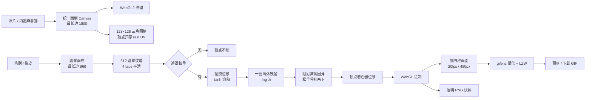

# 捏捏工坊 · SQUISH LAB

在照片上涂一块，只有这块会变成软糖。

**笔刷局部遮罩 · 拉伸鼓起 + 阻尼回弹 · 四档手感 · 四秒录成 GIF · 全程本地**

[在线试玩](https://hruiccc.github.io/RuiC-SquishLab/) · [源码](https://github.com/HRuiCcc/RuiC-SquishLab)

<div align="center">


</div>

<div align="center">
  
  <br />
  <sub>涂腮帮子 → 捏它 → 四秒录成 GIF</sub>
</div>

## 🧸 这是什么

捏捏工坊是一个跑在浏览器里的照片捏捏工具：

1. 选一张照片，或者直接用内置的麻薯猫；
2. 用笔刷在照片上涂出想捏的地方；
3. 切到「捏一捏」，按住涂过的地方拖，松手回弹；
4. 录四秒，得到一张会回弹的 GIF；也能存一张透明底的 PNG。

它和「整张照片一起变形」不一样：**只有涂过的区域参与物理计算，没涂到的地方钉死不动**。所以你可以只让腮帮子鼓起来、只让肚子抖、只让枕头陷下去，眼睛和背景保持原样。

> 灵感来自 Saba no Games 的 [もちほっぺ・メーカー](https://sabanogames.com/entertainments/moti_hoppe_maker/)。
> 形变部分（falloff、一圈向外鼓起的 ring 波、tanh 饱和、阻尼弹簧）是按原站的效果逆向重写的；界面保留自己的浅蓝糖果风。

## 🎬 两种状态

| 涂一涂 | 捏一捏 |
| :---: | :---: |
|  |  |
| 粉色是涂过的区域，只有这里会动 | 按住、拖动、松手回弹，不拖只点会轻轻弹一下 |

## ✨ 功能

- 🖌️ **笔刷遮罩**：大小可调，柔边 / 硬边，橡皮、撤销、清空齐全
- 🫠 **捏起来有体积感**：拉拽的同时，周围一圈向外鼓起，松手后阻尼弹簧抖两下
- 🎚️ **四档手感**：麻薯 / 果冻 / 棉花糖 / 橡皮，再加一根力度滑杆
- 🖐️ **多点触控**：鼠标、触屏、触控笔都能捏，几根手指同时上也行
- 🎞️ **四秒 GIF**：边捏边录，20fps，长边 480，自动加循环
- 🖼️ **透明 PNG**：当前画面直接裁成贴纸，能贴进聊天框
- 🔒 **全部本地**：没有后端、没有上传、没有统计；照片只在内存和 canvas 里
- ⌨️ **能用键盘**：B 涂、空格戳、R 复位、G 录制、P 存 PNG
- ♿ **照顾动效偏好**：`prefers-reduced-motion` 下关掉呼吸和过渡
- 🧩 **零依赖**：没有 npm 包、没有构建步骤，静态文件直接跑

## 🕹 怎么玩

1. **选照片**：点「选一张照片」，支持 JPG / PNG / WebP，动图取第一帧，也可以直接拖进来或 Ctrl+V 粘贴。
2. **涂一块**：在照片上刷出想捏的区域。涂得越大，回弹越夸张；没涂到的地方不会动。柔边适合腮帮子，硬边适合边界清楚的东西。
3. **捏一捏**：点「涂好了，去捏」。按住涂过的地方拖，松手回弹；不拖只点一下会轻轻弹一下。四档手感管的是软硬和抖动。
4. **录下来**：点「开始录制 GIF」，四秒后自动停，等它压完，预览满意再点「保存」。

> 内置的麻薯猫已经预先涂好了两块腮帮子，打开就能先捏为敬。

## ⚙️ 工作原理



**核心链路要点**

1. **遮罩就是权重**：笔刷画在一张独立的遮罩画布上，上传成 512 的 R8 纹理；顶点着色器每次采样时做 4 taps 平滑，避免边界按网格分辨率折成锯齿。权重为 0 的地方位移乘以 0，完全不动。
2. **拉拽加一圈鼓起**：每个抓取点给附近顶点一个平滑的位移（中心平坦、边缘收住），再叠加一圈在半径 1/3 处最大的向外膨胀。前者让脸颊跟着手指走，后者让脸颊看起来是鼓起来的，而不是被拉平。
3. **拉不远，所以不糊**：单次拉拽长度用 `tanh` 饱和在 `stretch × radius` 以内，拖再远也只会到这个上限；同时捏取半径会随拉拽稍微变大。这是原站看起来像软糖、而不是像涂抹的关键。
4. **松手是弹簧，不是动画**：每个抓取点在释放后由一个二阶阻尼弹簧送回 0，频率和阻尼由手感参数决定，抖两下才停。拖动过程中也有一次更硬的弹簧跟随。
5. **GIF 在本地压**：录制时直接 `drawImage` 抓 canvas 帧（20fps，长边 480），用 [gifenc](https://github.com/mattdesl/gifenc) 做 256 色量化和 LZW；服务器全程不参与。

## 🎛 手感参数

| 手感 | 捏取范围 | 拉伸量 | 晃动速度 | 阻尼 | 鼓起 |
| --- | --- | --- | --- | --- | --- |
| 麻薯 | 0.22 | 0.55 | 9 | 0.19 | 0.10 |
| 果冻 | 0.20 | 0.68 | 11.5 | 0.08 | 0.16 |
| 棉花糖 | 0.27 | 0.46 | 6.5 | 0.12 | 0.08 |
| 橡皮 | 0.16 | 0.72 | 13 | 0.30 | 0.18 |

捏取范围和拉伸量都是相对图片短边的比例；拉伸量决定最远能拉多长，阻尼越小回弹越久，鼓起决定那圈向外膨胀的强度。

## 🚀 本地运行

```bash
git clone https://github.com/HRuiCcc/RuiC-SquishLab.git
cd RuiC-SquishLab
python3 -m http.server 5173
```

打开 <http://localhost:5173>。

> 项目用了 ES Module，不能直接双击 `index.html`（`file://` 会被浏览器拦），需要起一个静态服务器。仓库没有构建步骤，也没有 npm 依赖。

## 🗂 目录结构

```text
RuiC-SquishLab/
├── index.html
├── css/
│   └── style.css
├── js/
│   ├── app.js        # 界面、模式切换、笔刷、上传、导出
│   ├── engine.js     # WebGL 网格、弹簧物理、遮罩权重
│   ├── recorder.js   # 抓帧、GIF 编码、PNG 快照
│   ├── sample.js     # 内置麻薯猫 SVG
│   └── audio.js      # 合成的捏捏声
├── assets/
│   ├── favicon.svg
│   ├── fonts/        # Gabarito（OFL）
│   └── wechat-donate.png
├── vendor/
│   └── gifenc.esm.js
├── docs/             # README 用的截图和演示
├── THIRD-PARTY.md
└── LICENSE
```

## ⌨️ 快捷键

| 按键 | 作用 |
| --- | --- |
| `B` | 切到「涂一涂」 |
| `空格` | 戳一下涂过的地方 |
| `R` | 复位形变 |
| `G` | 开始 / 停止录制 |
| `P` | 保存透明 PNG |

## 🔒 隐私

- 照片不会离开你的浏览器，没有上传接口。
- 页面加载完之后不需要网络也能继续用。
- GIF 和 PNG 都是本地生成，直接进下载文件夹。
- 没有埋点、没有账号、没有 cookie。

## 🧱 兼容性与已知限制

- 需要 WebGL2；Chrome、Edge、Safari、Firefox 的现代版本都可以。
- 照片最长边会缩到 1800，遮罩最长边 960，够用但不适合印刷。
- GIF 固定四秒、20fps、长边 480。细节多的照片大概 1 到 5MB。
- 动图只取第一帧。
- iOS Safari 保存 Blob 下载时可能会先打开新标签页，长按保存即可。
- 手指也能涂，但要涂细一点还是用鼠标或触控笔。

## 🙏 致谢

- [gifenc](https://github.com/mattdesl/gifenc)：浏览器里的 GIF 量化与编码
- [Tabler Icons](https://github.com/tabler/tabler-icons)：界面线性图标
- [Gabarito](https://github.com/naipefoundry/gabarito)：拉丁字母与数字
- 灵感：[もちほっぺ・メーカー](https://sabanogames.com/entertainments/moti_hoppe_maker/) by Saba no Games

第三方许可证全文见 [THIRD-PARTY.md](THIRD-PARTY.md)。

## 📄 License

[MIT](LICENSE) © 2026 HRuiCcc

## 赞赏支持

<div align="center">
  
  <p>微信扫码赞赏</p>
</div>
